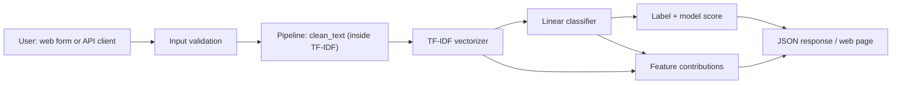

# NewsGuard — Fake News Pattern Detection (ML demo)

NewsGuard is a small, end-to-end machine-learning project: an NLP classifier that
estimates whether a news article **resembles the REAL or FAKE examples in a labelled
training dataset**, returns an uncalibrated *model score*, lists the words and phrases
that influenced the decision, and serves everything through a Flask web interface and a
REST API.

> **NewsGuard is not a fact-checking service.** It does not verify claims, articles or
> publishers. A prediction means "this text looks statistically like the examples the
> model was trained on", nothing more. Do not use it to label people, outlets or content
> as truthful or false.

## 1. Problem statement

Misinformation detection is often framed as text classification. This project shows the
whole workflow honestly: dataset hygiene (deduplication, leakage precautions),
reproducible training, held-out evaluation, transparent explanations, a tested API, and
deployment, while documenting what such a model can and cannot tell you.

## 2. Features

* Single scikit-learn `Pipeline` (TF-IDF → classifier) so training and inference share
  exactly the same preprocessing.
* Logistic Regression baseline compared with a Linear SVM on **validation** data; the
  chosen model is evaluated **once** on a held-out test set.
* Dataset validation, label normalisation, deduplication (exact + near-duplicate),
  conflicting-label removal, leakage precautions, optional time-based split.
* Metrics computed at training time and stored in `models/model_metadata.json`
  (accuracy, precision/recall/F1, per-class report, confusion matrix, ROC-AUC).
* Transparent per-term explanations (TF-IDF weight × coefficient), not SHAP.
* Responsive, accessible web UI (labels, keyboard navigation, skip link, dark mode,
  loading/error states, clear button, responsible-use notices).
* REST API with validation, payload limits, safe JSON errors and a health endpoint.
* One shared `PredictionService` used by both web UI and API.
* About 80 automated tests (79 at packaging time) that use a tiny temporary *synthetic* model (no dataset needed).

## 3. Architecture



Training: `train.py` → load → validate/clean/deduplicate → split → fit on train → select on
validation → test once → save `models/newsguard_pipeline.joblib` + `models/model_metadata.json`.

## 4. Technology stack

Python 3.11+, pandas, NumPy, SciPy, scikit-learn (TF-IDF, Logistic Regression, LinearSVC),
joblib, Flask, Gunicorn, python-dotenv, pytest. Frontend: HTML5, CSS3, vanilla JavaScript,
Jinja templates. No database, Docker, authentication or paid API.

## 5. Project structure

```
NewsGuard/
├── app.py                  # Flask app factory + web page (gunicorn app:app)
├── api.py                  # REST API blueprint: /health, /api, /predict, error handlers
├── predict.py              # Shared PredictionService (validation, loading, scoring)
├── explain.py              # TF-IDF feature-contribution explanations
├── preprocess.py           # build_text / clean_text (shared by training and inference)
├── train.py                # Data loading, cleaning, splitting, training, evaluation, saving
├── synthetic_data.py       # Tiny synthetic corpus for smoke tests ONLY
├── config.py               # Settings (env-overridable), limits, training constants
├── requirements.txt        # Pinned runtime dependencies
├── requirements-dev.txt    # + pytest
├── Procfile                # Gunicorn start command (Heroku-style hosts)
├── render.yaml             # Optional Render blueprint
├── pytest.ini  .gitignore  .env.example  LICENSE  README.md
├── data/        README.md, .gitkeep        # put True.csv / Fake.csv here (git-ignored)
├── models/      README.md, .gitkeep        # train.py writes the model + metadata here
├── templates/   index.html
├── static/      css/style.css, js/app.js
├── tests/       conftest.py, test_preprocess.py, test_predict.py, test_api.py,
│                test_explain.py, test_train.py
└── notebooks/   exploratory_analysis.ipynb (optional)
```

## 6. Dataset

Default: the **ISOT Fake News Dataset** (University of Victoria): `True.csv` (REAL, Reuters)
and `Fake.csv` (FAKE, outlets flagged by fact-checkers). It is **not** included here; see
[`data/README.md`](data/README.md) for download pointers, attribution and licence notes
(I did not verify the licence text — check it yourself before redistributing anything).

## 7. Installation

Requires **Python 3.11 or newer** (`pandas 3` needs 3.11+).

### Windows PowerShell

```powershell
Expand-Archive .\NewsGuard.zip -DestinationPath . -Force
Set-Location .\NewsGuard
python --version                      # 3.11+; use `py -3.11` if `python` is not found
python -m venv .venv
.\.venv\Scripts\Activate.ps1          # if blocked: Set-ExecutionPolicy -Scope CurrentUser RemoteSigned
python -m pip install --upgrade pip
pip install -r requirements-dev.txt
```

### Linux / macOS

```bash
unzip NewsGuard.zip && cd NewsGuard
python3 -m venv .venv && source .venv/bin/activate
python -m pip install --upgrade pip
pip install -r requirements-dev.txt
```

## 8. Run the tests

```powershell
python -m pytest
```

Tests build a small synthetic model in a temp folder; no dataset, no network, a few seconds.

## 9. Dataset setup and training

1. Put `True.csv` and `Fake.csv` in `data/`.
2. Train and evaluate:

```powershell
python train.py                 # random stratified 70/15/15 split
python train.py --split time    # optional: chronological split (harder, more realistic)
```

Smoke test **without** the dataset (synthetic, meaningless metrics, output goes to the
git-ignored `models/_synthetic_smoke/`):

```powershell
python train.py --synthetic
python predict.py --model-dir models\_synthetic_smoke --text "ministry committee parliament budget statement officials"
```

Training writes `models/newsguard_pipeline.joblib` and `models/model_metadata.json`.
The app never trains at start-up.

## 10. Run locally

```powershell
python app.py        # http://127.0.0.1:5000  (development server, local use only)
```

To try the app with the synthetic smoke model instead of a real one:

```powershell
$env:NEWSGUARD_MODEL_PATH = "models\_synthetic_smoke\newsguard_pipeline.joblib"
$env:NEWSGUARD_METADATA_PATH = "models\_synthetic_smoke\model_metadata.json"
python app.py
```

(The UI then shows a warning that the model was trained on synthetic data.) On Linux/macOS you
can run the production server locally with `gunicorn app:app --bind 127.0.0.1:8000`;
Gunicorn does not run on Windows.

## 11. API documentation

| Method | Path | Description |
|--------|------|-------------|
| GET | `/health` | `{"status": "ok"\|"degraded", "model_available": bool, "model_version": ..., "synthetic_model": ...}` — always HTTP 200; `degraded` means no usable model. No paths or secrets. |
| GET | `/` | Web interface. Clients sending `Accept: application/json` get the API description instead. |
| GET | `/api` | API description and limits (JSON). |
| POST | `/predict` | Body: JSON with `title` and/or `text` (strings). |

Status codes: **200** success · **400** invalid JSON / content type / fields / length ·
**413** body larger than `MAX_CONTENT_LENGTH` (default 256 KiB) · **503** model unavailable ·
**500** unexpected error (generic message; details only in server logs).
Errors look like `{"error": {"code": "invalid_input", "message": "..."}}`.

Input limits (configurable in `.env`): title ≤ 300 chars, text ≤ 20 000 chars, title+text ≥ 20 chars.
Text with no vocabulary known to the model (e.g. non-English) is rejected with 400.

### Example request / response

```powershell
$body = @{ title = "Example headline"; text = "Example article body with enough words to analyse." } | ConvertTo-Json
Invoke-RestMethod -Uri http://127.0.0.1:5000/predict -Method Post -ContentType "application/json" -Body $body
```

```bash
curl -X POST http://127.0.0.1:5000/predict -H "Content-Type: application/json" \
     -d '{"title": "Example headline", "text": "Example article body ..."}'
```

Response shape (**values below are placeholders for illustration; real values come from the model**):

```json
{
  "prediction": "<REAL|FAKE>",
  "model_score": "<0-100>",
  "score_type": "model_confidence",
  "score_note": "model_score is the model's uncalibrated confidence ...",
  "explanation": [
    {"term": "<word or phrase>", "pushes_toward": "<REAL|FAKE>",
     "supports_prediction": true, "contribution": "<number>"}
  ],
  "explanation_note": "...",
  "model_version": "1.0.0",
  "disclaimer": "...",
  "metadata": {"classes": ["FAKE", "REAL"], "score_method": "predict_proba",
               "known_terms": "<int>", "input_characters": "<int>",
               "trained_on_synthetic_data": false, "trained_at_utc": "..."}
}
```

## 12. Evaluation metrics

**No metrics are published in this README.** They must come from your own training run.
After `python train.py`, read them from `models/model_metadata.json`:

```powershell
python -c "import json; m=json.load(open('models/model_metadata.json')); print(json.dumps(m['test'], indent=2))"
```

The file also holds dataset size/class counts, rows removed during cleaning, split sizes,
validation scores of both candidates, and the training configuration. When you publish
results, copy them from that file and state the split strategy (random vs time).

*(Paste your results here after training. Do not edit numbers by hand.)*

## 13. Explanation methodology

The classifier is linear, so the decision value is `intercept + Σ (tf-idf_j × coefficient_j)`.
For each term in the submitted article, `tf-idf × coefficient` is its exact additive
contribution. scikit-learn stores one coefficient vector for the two classes: positive values
push toward `REAL` (`classes_[1]`), negative toward `FAKE`. The API reports each term's
magnitude, the label it pushes toward, and whether that supports the predicted label
(up to 6 supporting + 4 opposing terms). The intercept is not shown.
These are descriptions of model behaviour, not causal evidence; a highlighted word does not
prove an article is misinformation.

The **model score** is the model's probability for its predicted label (Logistic Regression)
or a sigmoid of the margin (Linear SVM). Either way it is **uncalibrated confidence**, not the
probability that the article is true or false. No calibration is applied.

## 14. Screenshots

*Placeholders — add real screenshots after running the app:*

* `docs/screenshot-home.png` — _not yet captured_
* `docs/screenshot-result.png` — _not yet captured_

## 15. GitHub publishing

```powershell
git init -b main                       # if this folder is not yet a repository
git add .
git status                             # review carefully
```

Checks **before every commit**:

```powershell
git ls-files | Select-String -Pattern "\.env$|\.csv$|\.venv|__pycache__"          # expect no output (.env.example is fine)
git ls-files | ForEach-Object { Get-Item $_ } | Where-Object { $_.Length -gt 5MB }  # large files; GitHub blocks >100 MB
git grep -nI -E "(api[_-]?key|secret|password|token)\s*[:=]"                       # expect nothing sensitive
```

Never commit: `.env`, the dataset CSVs (licence not verified), `.venv`, caches, or
`models/_synthetic_smoke/`. Open `LICENSE` and replace `[Your Name]`.

After training on the **real** dataset, the model files appear as new files — they are
required for deployment, so commit them once you have checked their size
(`Get-ChildItem models | Select Name, Length`).

```powershell
git commit -m "Initial commit: NewsGuard"
git remote add origin https://github.com/<your-username>/NewsGuard.git   # create the empty repo on github.com first
git push -u origin main
```

## 16. Deployment

Public URL: **not deployed yet** — add it here only after you have tested it.

Constraints to know (verify on the host's current docs before relying on them): free web
services of the kind Render offers have a small RAM allowance (commonly 512 MB), sleep after
idle time (slow first request), may restart at any time and have an ephemeral disk. Hence:
the model is a read-only file committed to the repo, loaded at start-up, never retrained; one
Gunicorn worker; TF-IDF is capped at 50 000 features.

Example with Render (Web Service from your GitHub repo):

| Setting | Value |
|---------|-------|
| Build command | `pip install -r requirements.txt` |
| Start command | `gunicorn app:app --bind 0.0.0.0:$PORT --workers 1 --threads 2 --timeout 60` |
| Health check path | `/health` |
| Environment | `PYTHON_VERSION` = a 3.11.x version (see Render's current Python-version docs) |

`render.yaml` encodes the same settings; `Procfile` serves Heroku-style hosts (they additionally
need a `runtime.txt` such as `python-3.11.x`, if the host requires one). Debug mode stays off
unless you set `FLASK_DEBUG=1`.

Environment variables (all optional): `PORT` (set by host), `HOST`, `FLASK_DEBUG`,
`NEWSGUARD_MODEL_PATH`, `NEWSGUARD_METADATA_PATH`, `MAX_CONTENT_LENGTH`, `MAX_TEXT_CHARS`,
`MAX_TITLE_CHARS`, `MIN_INPUT_CHARS`. No secrets or API keys are required.

Verify a deployment (replace the URL):

```powershell
$base = "https://<your-service-url>"
Invoke-WebRequest "$base/" | Select-Object StatusCode
Invoke-RestMethod "$base/health"
Invoke-RestMethod "$base/predict" -Method Post -ContentType "application/json" -Body (@{ text = "Paste a realistic English news paragraph here." } | ConvertTo-Json)
```

`/health` must show `"model_available": true` and `"synthetic_model": false`.

## 17. Known limitations and responsible use

* **Not fact-checking.** The model sees only words, no sources, images, dates or external facts.
* **Source/style leakage.** ISOT's classes come from different outlets. Cleaning removes datelines,
  URLs and source markers, but style differences remain, so very high test scores mostly show the model
  separates *these sources*. Expect much worse performance on other publishers, topics, languages
  and years. Use `--split time` for a harsher estimate; a grouped-by-source split would be better still
  but ISOT has no source column.
* **Random split optimism.** Articles on the same events appear in train and test.
* **Labels are noisy proxies.** "FAKE" = "from a flagged outlet", "REAL" = "from Reuters".
* **Scores are uncalibrated** and can be confidently wrong. Satire, opinion, breaking news and
  non-English text are out of scope.
* **Pickle safety.** Only load model files you trained yourself.
* **Possible bias.** The model can encode topical and political associations of its sources.

## 18. Troubleshooting

| Symptom | Fix |
|---------|-----|
| `python` not found | Use `py -3.11` (Windows) or install Python 3.11+. |
| Activation blocked | `Set-ExecutionPolicy -Scope CurrentUser RemoteSigned`, then activate again. |
| `ModuleNotFoundError` | Activate `.venv` and run `pip install -r requirements-dev.txt`; run commands from the project root. |
| `Dataset error: 'True.csv' not found` | Put the files in `data/` or pass `--data-dir`. |
| `/health` says `degraded`, `/predict` returns 503 | No model: run `python train.py` (or set `NEWSGUARD_MODEL_PATH`). On a host, commit the model files. |
| 503 after upgrading packages | Pickle/version mismatch: retrain with the same pinned `requirements.txt`. |
| 400 "no terms the model recognises" | Input is not English news-like text. |
| Port already in use | Set `PORT=5001` in `.env` or the environment. |
| First request very slow on a free host | The service was asleep; retry. |
| `gunicorn` fails on Windows | Expected; use `python app.py` locally. |

## 19. Future improvements

Source-grouped or time-based evaluation on more datasets; probability calibration evaluated on
separate validation data; cross-dataset testing; multilingual support; rate limiting; request
logging/metrics; batch endpoint.

## 20. Author and repository

Author: `<your name>` · Repository: `https://github.com/<your-username>/NewsGuard` (replace after publishing) ·
Licence: MIT (code only; the dataset has its own terms).
